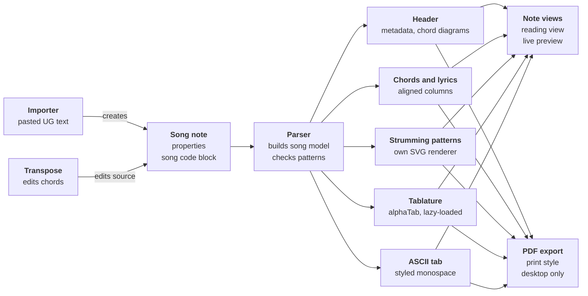
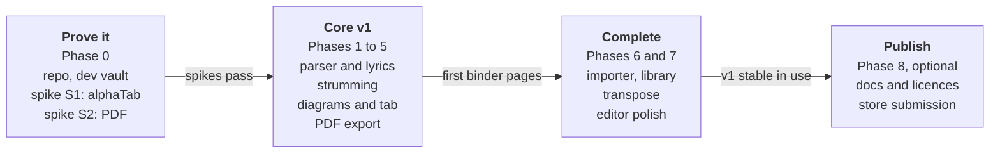

# Songfolio — Requirements & Plan

Oct 27, 2026 · Pedro Anastácio

> The spec, first written as a PDF and kept here as Markdown. Decisions taken since, phase by
> phase, are in [HANDOFF.md](HANDOFF.md).
>
> This is the original design, not kept up to date. The syntax, properties and settings as they
> work now are in the [README](../README.md): for example, `status` takes `to_start` (not
> `backlog`), strumming patterns are checked in any n/4 time, and `duration` drives autoscroll.

## Overview

Songfolio is a new Obsidian plugin that renders a complete guitar song from one `songsheet`
code block: chords over lyrics, sections, strumming patterns and tablature, with a styled header
and a print-ready PDF export.

**Primary user:** Pedro, learning and playing songs on desktop and an Android tablet,
occasionally a phone. Publishing to the community store is a possible later step.

**Goals**

- Write a whole song, including strumming and tab, inside one block, without hand-drawing ASCII.
- Show chord diagrams, strumming patterns and song metadata at the top of every song.
- Export one song at a time to a styled PDF, possibly multi-page, to file in a physical binder.
- Keep a song library in a Bases view driven by note properties.
- Paste a song from Ultimate Guitar text and get a usable song note.
- Transpose chords (nice to have).

**Non-goals for v1**

- Audio playback of strumming or tab.
- Standard music notation.
- Importing from URLs or PDFs.
- Compiling multi-song songbooks; the binder is assembled by hand.
- ChordPro import or export (possible later).

## Decisions made

| Decision | Choice | Why |
| --- | --- | --- |
| Fork vs. companion vs. new plugin | New plugin, Songfolio, with its own `songsheet` block (name configurable) | Strumming and tab live inside the song block, so the parser must be ours. Its own block name lets it coexist with other chord plugins. |
| Source format | Chords over lyrics, plus `%` directives | Easiest to read raw and matches pasted Ultimate Guitar text. ChordPro is a possible export later. |
| Strumming | Own syntax and own SVG renderer, up to 16th notes, accents, muted strokes, one pattern per section | No library covers this well; the notation is small. |
| Tablature | alphaTex rendered by alphaTab, tab staff only, no playback | Maintained, supports tab-only with rhythm, much easier to write than ASCII. |
| Pasted ASCII tab | Kept as a styled fallback block | Ultimate Guitar paste has no rhythm, so conversion to alphaTex can only be best effort. |
| Metadata | Frontmatter properties, read by the plugin and by Bases | One source of truth for the header and the library. |
| Importer | Pasted Ultimate Guitar text only | URLs likely break their terms; PDFs are unreliable. |
| Platforms | Rendering on desktop and Android; PDF export desktop only | Matches how the songs are used. |

## Song block syntax

A song is one fenced block named `songsheet`; the name can be changed in settings. A plain song
is just chord lines over lyric lines, so existing songs move over by renaming their block. New
features are lines starting with `%`.

```
%pattern A 8: d.d. dudu
%pattern B 16: D.du .udu x.du .udu
%shape Fm 133111

[Intro]
%strum A
C G F G

[Verse]
%strum A
C                  G
First lyric line here
F                            G
Second lyric line

[Solo]
%tab
:8 8.3{h} 10.3{v} 10.3 8.3 6.3
%endtab

[Outro]
%ascii
e|-----------------|
B|--9/11-11--------|
%endascii
```

**Chords and lyrics**

- Chord lines over lyric lines, auto-detected.
- Line markers: `%c` at the end of a line forces a chord line, `%t` forces a lyric line.
- `[Name]` on its own line starts a section.

**Chord shapes**

- `%shape <chord> <frets>` at the top of the block fixes the fingering used for that chord, on
  screen and in the PDF.
- Frets run from the low E string to the high E string; `x` is a muted string, `0` an open one.
- The line is written for you when you pick an alternative fingering from a diagram, and can be
  edited by hand.
- Chords without a `%shape` line use the first fingering in the library.

**Strumming patterns**

- `%pattern <name> <grid>: <slots>` defines a named pattern once, at the top of the block.
- `<grid>` is `8` or `16`: the note value of one slot.
- Slots are written in groups of 4, for both grids. In 4/4 an 8th pattern is 2 groups and a 16th
  pattern is 4 groups.
- The parser ignores spaces and checks the slot count against the grid and time signature. A
  wrong count is shown as an error on the block.
- Slot symbols:

  | Symbol | Meaning |
  | --- | --- |
  | `d` | Down stroke |
  | `u` | Up stroke |
  | `x` | Muted stroke; direction follows the slot (on-beat down, off-beat up) |
  | `.` | No stroke; the hand keeps moving |
  | `D` `U` `X` | The same stroke, accented |

- `%strum <name>` on the line after a section header applies that pattern to the section, until
  the next section.
- Every pattern is drawn in the song header. Each section shows its pattern's name next to its
  title.

**Tablature**

- `%tab ... %endtab` holds alphaTex beats only. The plugin adds the tab-only staff and the tuning
  from the `tuning` property.
- Chord names above tab bars use alphaTex's chord beat effect, to be confirmed in the tab spike.

**ASCII tab fallback**

- `%ascii ... %endascii` holds raw ASCII tab, shown in a styled monospace box that never wraps.
- This is what the importer produces for pasted tab, since pasted ASCII has no rhythm.

## Song properties and library

Each song note carries its metadata as frontmatter properties. The plugin reads them to draw the
song header, and a Bases view reads the same properties to list the library.

| Property | Type | Example | Notes |
| --- | --- | --- | --- |
| `title` | Text | Song title | Defaults to the file name if empty. |
| `artist` | Text | Artist name | |
| `key` | Text | C | Key of the chord shapes as written. The header also shows the sounding key, computed from `capo`. |
| `capo` | Number | 1 | 0 or empty means no capo. |
| `tuning` | Text | EADGBE | Also sets the tab staff tuning. |
| `tempo` | Number | 65 | In bpm. |
| `time` | Text | 4/4 | Fixed at 4/4 in v1; other time signatures come later. Used to validate strumming slot counts. |
| `difficulty` | Text | intermediate | Fixed values: beginner, intermediate, advanced. |
| `status` | Text | learning | Fixed values: backlog, learning, polishing, learned. |
| `started` | Date | 2026-10-27 | Date started learning. |
| `learned` | Date | | Date learned. |
| `source` | Text | Link to where the song came from | |
| `tags` | Tags | genre/rock, technique/fingerpicking | Nested tags keep genre and technique separate in filters. |

**Library**

- A command creates a song template note with all properties pre-filled.
- A command creates a starter `Songs.base` file with views such as "Learning now", "By artist"
  and "Learned".
- The importer fills the properties it can find in pasted text, such as tuning, capo and key.

## Functional requirements

Must items make up v1, the version that produces your first binder pages. Should and Could items
follow in later phases.

| ID | Area | Requirement | Priority |
| --- | --- | --- | --- |
| R1 | Rendering | Render `songsheet` blocks in reading view and live preview, with chord and lyric alignment kept when lines wrap. | Must |
| R2 | Rendering | Show section titles, with the section's strumming pattern name beside them. | Must |
| R3 | Header | Show title, artist, sounding key, capo, tuning, tempo and difficulty from properties. | Must |
| R4 | Header | Show a diagram for every distinct chord in the song. Let you pick an alternative fingering from a diagram; the choice is saved in the song and used on screen and in the PDF. | Must |
| R5 | Header | Show every named strumming pattern. | Must |
| R6 | Strumming | Draw patterns as SVG: beat counts (1 e & a), stroke arrows, accents, muted strokes, rests. | Must |
| R7 | Strumming | Show a clear error on the block for a wrong slot count or an unknown pattern name. | Must |
| R8 | Tab | Render `%tab` alphaTex as a tab-only staff with rhythm, using the song's tuning. | Must |
| R9 | Tab | Render `%ascii` blocks as styled monospace that scrolls instead of wrapping. | Must |
| R10 | PDF | Export the current song to PDF on desktop: light print style, header on page 1, no strum or tab block split across pages. | Must |
| R11 | Importer | Command "Import song from clipboard": converts Ultimate Guitar text into a new song note with properties and a `songsheet` block. | Should |
| R12 | Library | Commands for the song template and the starter `Songs.base`. | Should |
| R13 | Transpose | Transpose chords up or down in the block source, and toggle sharps or flats. Tab is never transposed. | Should |
| R14 | Editor | Syntax highlighting of chords and `%` directives in source mode, only if typing stays fast; no live-preview editor extension. | Could |
| R15 | Editor | Autocomplete for directives and pattern names. | Could |
| R16 | Importer | Best-effort conversion of an `%ascii` block to `%tab`, with you filling in the rhythm. | Could |
| R17 | Rendering | Autoscroll at a speed set per song. | Could |

**Non-functional requirements**

- Works on Obsidian mobile on Android: no Node or Electron APIs outside the desktop-only PDF code.
- A song with 4 tab blocks renders in under 1 second on the Android tablet. To be measured in the
  tab spike.
- Follows the current theme on screen; prints with its own light style.
- Meets the community store guidelines from day one, so publishing stays an option.

## Architecture

One parser feeds every renderer, on screen and in the PDF.



Plugin architecture: parser, 5 renderers, 2 outputs. The parser is the only place that
understands the syntax; every renderer reads its song model, and the PDF prints the same
rendered output with a print style.

**Technology**

- TypeScript, built with esbuild from Obsidian's sample plugin template.
- Rendering through Obsidian's code block processor for `songsheet`, in reading view and live
  preview. No editor extension: the block shows its source while the cursor is inside and renders
  when you leave it, which keeps typing fast.
- The parser is pure TypeScript with no Obsidian imports, so it is unit-tested with Vitest against
  fixture songs.
- Chord parsing and transposition are Songfolio's own; fingerings come from chords-db, and
  diagrams are drawn as hand-written SVG.
- Strumming drawn as hand-written SVG.
- Tablature with alphaTab (`@coderline/alphatab`): tab staff only, player off, imported only when
  a song contains `%tab`.
- Header data read from the note's frontmatter, re-rendered when properties change.
- PDF through print CSS plus Obsidian's export, or the plugin's own export command if spike S2
  fails.

**Suggested source layout:** `src/parser`, `src/model`, `src/render/{header,lyrics,strum,tab,ascii}`,
`src/commands/{import,transpose,template}`, `src/print`, `test/fixtures`.

## Risks and technical spikes

Two risks can break the plan: alphaTab running well inside Obsidian on Android, and PDF export
capturing tabs that render asynchronously. Both get a throwaway spike in Phase 0, before any real
code.

| Risk | Impact | Spike or mitigation |
| --- | --- | --- |
| alphaTab inside Obsidian: workers, music font loading, large bundle | Tabs don't render, or the plugin is slow to load | S1: render one `%tab` block on desktop and Android. Disable the player and workers; load alphaTab only when a song has a tab. Study how Tab Flow handles fonts and assets. |
| alphaTab speed on the Android tablet | Laggy scrolling in long songs | S1: time a song with 4 tab blocks; render tabs only when scrolled into view. |
| Obsidian's "Export to PDF" captures the page before tabs finish rendering, or at the wrong width | Blank or cut tabs in the PDF | S2: export a test song natively. If it fails, build the plugin's own export: render into a hidden print container, wait for every block, then print. |
| Page breaks splitting a tab or strum block | Ugly binder pages | Print CSS that avoids breaks inside blocks; checked in S2. |
| Missing chord shapes for rare chords | Empty diagram boxes | Use chords-db's chord data; later add a directive for custom shapes. |
| Ultimate Guitar paste formats vary | Importer misreads lines | Build the importer from 10 or more real pasted songs kept as test fixtures. |
| Licences of reused code | Blocks community store publishing | Keep the licence notice of every bundled library; check alphaTab's licence before Phase 4. |

## Phased development plan

v1 lands at the end of Phase 5, with songs printed for the binder.



Roadmap: 9 phases in 4 stages, 3 gates. The riskiest work comes first, and v1 is defined as
songs you can print. Each phase ends with something you can use in your own vault.

1. **Phase 0: setup and spikes.** Create the repo from Obsidian's sample plugin, a dev vault with
   5 real songs, hot reload and Vitest. Run spike S1 (alphaTab on desktop and the Android tablet)
   and spike S2 (native PDF export of a song with tab).
   - Exit: alphaTab renders on both devices, and the PDF route is chosen.
2. **Phase 1: parser and lyrics.** Song model, sections, chords over lyrics, header text from
   properties, errors shown on the block.
   - Exit: your existing songs render the same in a `songsheet` block.
3. **Phase 2: strumming.** Pattern parsing and slot-count checks, SVG renderer, patterns in the
   header, pattern names on sections.
   - Exit: your example song's two 8th-note patterns render correctly, plus a 16th test pattern
     with accents and mutes.
4. **Phase 3: chord diagrams.** Diagram row in the header, choosing an alternative fingering per
   chord, and the capo-aware sounding key.
   - Exit: every chord in 5 test songs shows a diagram or a clear placeholder.
5. **Phase 4: tablature.** `%tab` through alphaTab with tuning from properties, lazy loading, and
   `%ascii` styling.
   - Exit: the solo from your example, rewritten in alphaTex, renders; the tablet speed target is
     met.
6. **Phase 5: PDF export, completing v1.** Print style, page-break rules, and the plugin's own
   export command if S2 needs it.
   - Exit: 3 songs printed and filed in the binder look right.
7. **Phase 6: library and importer.** Template and starter base commands; clipboard importer built
   against 10 or more pasted songs.
   - Exit: 5 pasted songs import needing only small fixes.
8. **Phase 7: transpose and editor polish.** Transpose commands, syntax highlighting,
   autocomplete, autoscroll.
9. **Phase 8: publish, optional.** README with a syntax reference, licence notices, GitHub release
   workflow, community store submission.

This document can serve as the spec for each phase if you build with Claude Code: one phase per
session, starting from its exit criteria.

## Open decisions

The defaults below are what this plan assumes. Any of them can change before Phase 1 starts.

- Accent notation: lowercase strokes, uppercase accents (`D`, `U`, `X`), so the groups of 4 stay
  aligned.
- Muted stroke direction: implied by the slot position.
- Time signatures: 4/4 only in v1; others in a later version.
- Chords under patterns: the section's chord line is enough.
- Status values: backlog, learning, polishing, learned.
- Custom chord shapes: not a v1 feature, but the `%shape` line can hold them later at little cost.
- Saving a chosen chord shape: one `%shape` line per chord at the top of the block.
- Inline chord shapes such as `C[x32010]`: not used in existing songs, so not supported (the
  chord name is shown).
- Block name: `songsheet`, configurable in settings.
- Editing experience: plain code block processor; no live-preview editor extension.
- Plugin name: Songfolio. Recheck the community store for a clash before publishing.

## Sources

- [alphaTex document structure](https://alphatab.net/docs/alphatex/document-structure): tab-only
  staves
- [alphaTab TabRhythmMode](https://alphatab.net/docs/reference/types/tabrhythmmode/): rhythm on
  tab-only staves
- [VexTab on GitHub](https://github.com/0xfe/vextab): syntax and licence terms
- [Tab Flow plugin](https://community.obsidian.md/plugins/tab-flow): alphaTab running inside
  Obsidian
- [Markdown Chords plugin](https://community.obsidian.md/plugins/markdown-chords): existing song
  block name
